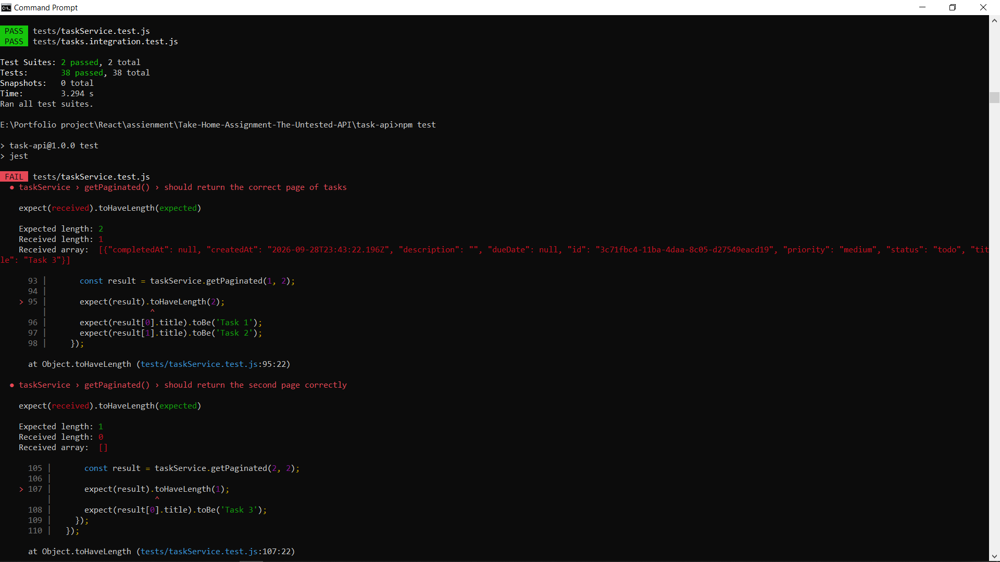
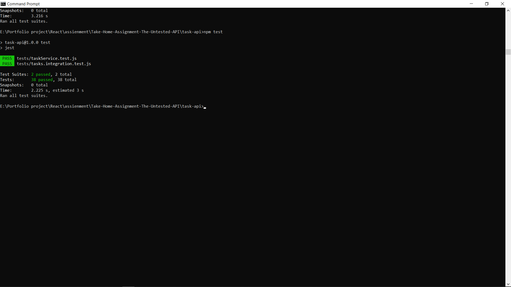
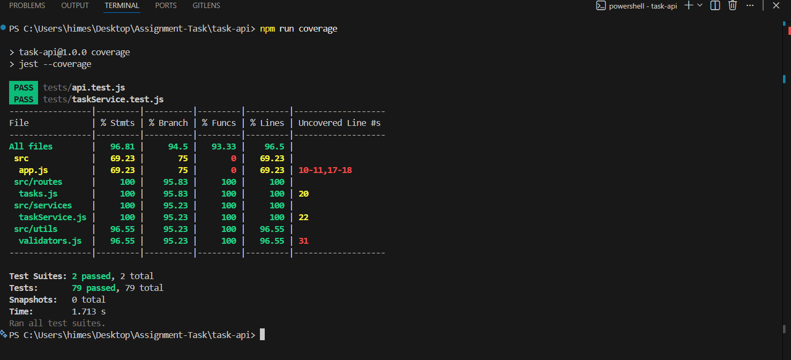

# Take-Home Assignment: The Untested API

**Candidate:** Ayush
**Role:** Full Stack Developer Intern, Taroo
**Stack:** Node.js, Express, Jest, Supertest
**Application directory:** `task-api`

---

## 1. Summary

I was given an unfamiliar Task Manager API with no tests. I read the code, wrote unit and integration tests, found and fixed a pagination bug, and added a new `PATCH /tasks/:id/assign` endpoint with its own tests.

| Item | Result |
|---|---|
| Tests | **38 passing** (19 unit, 19 integration) |
| Statement coverage | **91.61%** (target: 80%+) |
| Bugs found and fixed | Pagination offset error (`page * limit`) |
| New feature | `PATCH /tasks/:id/assign`, with validation, 404 handling, and reassignment |

**Links**

- GitHub repository: `[ADD FINAL GITHUB LINK]`
- Live API: `[ADD LIVE API LINK AFTER DEPLOYMENT]`

---

## 2. Project Structure

```
Take-Home-Assignment-The-Untested-API/
├── ASSIGNMENT.md
├── README.md
├── Submission.md
└── task-api/
    ├── screenshots/
    │   ├── coverage.png
    │   ├── pagination-bug.png
    │   └── test-results.png
    ├── src/
    │   ├── app.js
    │   ├── routes/tasks.js
    │   ├── services/taskService.js
    │   └── utils/validators.js
    ├── tests/
    │   ├── taskService.test.js
    │   └── tasks.integration.test.js
    ├── package.json
    └── jest.config.js
```

The API uses an **in-memory data store**, so all tasks are lost when the server restarts.

---

## 3. How to Run

From the `task-api` directory:

```bash
npm install
npm test                    # run all tests
npm test -- --coverage      # run tests with coverage report
npm start                   # start the API
```

The API runs at `http://localhost:3000`.

---

## 4. Testing Strategy

### Unit tests: `tests/taskService.test.js`

These test the service layer directly, with no HTTP involved. They cover:
`create()`, `getAll()`, `findById()`, `getByStatus()`, `getPaginated()`, `getStats()`, `update()`, `remove()`, `completeTask()`, and `assignTask()`.

### Integration tests: `tests/tasks.integration.test.js`

These use Supertest to send real HTTP requests to the Express app.

| Method | Endpoint | Covered |
|---|---|---|
| GET | `/tasks` | ✅ |
| GET | `/tasks?status=...` | ✅ |
| GET | `/tasks?page=...&limit=...` | ✅ |
| GET | `/tasks/stats` | ✅ |
| POST | `/tasks` | ✅ |
| PUT | `/tasks/:id` | ✅ |
| DELETE | `/tasks/:id` | ✅ |
| PATCH | `/tasks/:id/complete` | ✅ |
| PATCH | `/tasks/:id/assign` | ✅ |

### Edge cases covered

- Invalid or missing task title
- Invalid status, priority, and due date
- Updating, deleting, or completing a nonexistent task
- Pagination across multiple pages
- Assigning a nonexistent task
- Missing, empty, and whitespace-only assignee
- Reassigning an already assigned task

---

## 5. Bug Report: Pagination Offset

**Location:** `src/services/taskService.js`

**Expected behavior (1-based pagination):**

- Page 1 returns the first `limit` records
- Page 2 returns the next `limit` records
- Page 3 returns the following `limit` records, and so on

**Actual behavior:** The offset was calculated as:

```js
const offset = page * limit;
```

With `page=1&limit=2`, this gives `offset = 2`, so page 1 **skipped the first two records** and started at index 2 instead of 0. Every page was shifted forward by one full page.

**Fix:**

```js
const offset = (page - 1) * limit;
```

**How it was found:** Testing pagination against a known set of tasks showed page 1 returning the wrong records.

**Regression coverage:** Unit and integration tests check the contents of page 1 and page 2 for a known dataset.



*Test output showing the original implementation failing.*

---

## 6. New Feature: Assign Task

### Endpoint

```
PATCH /tasks/:id/assign
```

**Request body:**

```json
{ "assignee": "Ayush" }
```

### Behavior

| Scenario | Result |
|---|---|
| Existing task, valid assignee | `200` with the updated task |
| Nonexistent task | `404` |
| Missing assignee | `400` |
| Empty assignee | `400` |
| Whitespace-only assignee | `400` |
| Non-string assignee | `400` |
| Task already assigned | Reassigned to the new assignee |

### Implementation

- **`validators.js`:** `validateAssignTask()` rejects missing, empty, whitespace-only, and non-string values. The error message is `assignee is required and must be a non-empty string`.
- **`taskService.js`:** `assignTask(id, assignee)` returns `null` if the task doesn't exist. Otherwise it replaces the stored task with a copy that includes the new assignee.
- **`routes/tasks.js`:** The route validates the body, calls the service, and returns 400, 404, or 200 as appropriate.

```js
const assignTask = (id, assignee) => {
  const task = findById(id);
  if (!task) return null;

  const updated = { ...task, assignee };
  const index = tasks.findIndex((t) => t.id === id);
  tasks[index] = updated;

  return updated;
};
```

### Design decision: reassignment

If a task already has an assignee, the new value **replaces** it (for example, `Rahul → Ayush`). I chose this because the assignment did not forbid it, and blocking reassignment would force clients to add an "unassign" step for a common workflow. Unit and integration tests cover this explicitly.

---

## 7. Test Results

```bash
npm test
```

```
Test Suites: 2 passed, 2 total
Tests:       38 passed, 38 total
Snapshots:   0 total
```

19 unit tests and 19 integration tests.



---

## 8. Coverage Results

```bash
npm test -- --coverage
```

| File | Statements | Branches | Functions | Lines |
|---|---|---|---|---|
| **All files** | **91.61%** | **81.39%** | **90%** | **90.78%** |
| `src/app.js` | 69.23% | 75% | 0% | 69.23% |
| `src/routes/tasks.js` | 92.30% | 83.33% | 85.71% | 92.30% |
| `src/services/taskService.js` | 98.41% | 78.94% | 100% | 97.95% |
| `src/utils/validators.js` | 85.18% | 82.05% | 100% | 85.18% |

Overall statement coverage of **91.61%** exceeds the 80% target.

`src/app.js` has the lowest coverage, at 0% function coverage. I left it as is because the rest of the app is well covered. It would be the first thing to improve with more time (see the next section).



---

## 9. What I Would Test Next

1. Negative, zero, and non-numeric `page` and `limit` values
2. Requests for pages beyond the available range
3. A maximum `limit` to prevent very large responses
4. Very long `assignee` values
5. Concurrent updates to the same task
6. Malformed JSON request bodies
7. More request-body type validation across all endpoints
8. Error-handling middleware in `app.js`
9. Performance with a large number of in-memory tasks
10. Authentication and authorization around assignment

---

## 10. What Surprised Me

The pagination bug was a one-token mistake that reads as correct in a quick code review:

```js
page * limit        // looks reasonable
(page - 1) * limit  // correct for 1-based pages
```

It only showed up when I asserted exact page contents against known data. That is a good argument for testing boundary behavior directly instead of only checking that a response returns `200`.

I was also reminded that the in-memory store makes the project easy to run but means data does not survive a restart.

---

## 11. Requirements Checklist

| Requirement | Status |
|---|---|
| Unit tests for `taskService.js` | ✅ |
| Integration tests with Supertest | ✅ |
| Happy paths and edge cases | ✅ |
| 80%+ coverage (achieved 91.61%) | ✅ |
| Bug identified, documented, and fixed | ✅ |
| Regression tests for the bug | ✅ |
| `PATCH /tasks/:id/assign` implemented | ✅ |
| Assignment validation and 404 handling | ✅ |
| Reassignment behavior | ✅ |
| Tests for the new feature | ✅ |
| 38/38 tests passing | ✅ |

---

## 12. Final Notes

The repository contains the implementation, automated tests, the pagination bug fix, the assign-task feature, and this submission report.